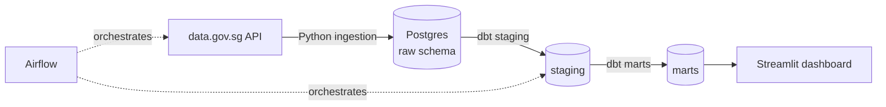

# 🏠 SG HDB Resale Pipeline

An end-to-end ELT pipeline that ingests Singapore HDB resale flat transactions from [data.gov.sg](https://data.gov.sg), models them with dbt in a Postgres warehouse, orchestrates monthly runs with Airflow, and serves insights through a dashboard.

> **Status:** 🚧 In progress. See [Roadmap](#roadmap).

---

<!--## Why this project -->

<!-- 2–3 sentences in your own words. E.g.: HDB resale prices are a hot topic in Singapore.
I wanted to answer questions like "which towns saw the fastest price growth?" while
practising a production-style data stack: containerised services, tested transformations
and scheduled orchestration. -->

## Architecture



<!-- Later: replace with a proper diagram in docs/architecture.png (excalidraw.com works well) -->

## Tech stack

| Layer | Tool |
|---|---|
| Ingestion | Python (`requests`, `psycopg`) |
| Storage | PostgreSQL 17 (Docker) |
| Transformation | dbt Core (`dbt-postgres`) |
| Metrics / semantic layer | MetricFlow |
| Orchestration | Apache Airflow 3 (Docker) |
| Dashboard | Streamlit |
| Env / packaging | Docker Compose, uv |
| CI | GitHub Actions |

## Data source

- **Dataset:** HDB Resale Flat Prices (Jan 2017 onwards), ~240k rows, updated monthly
- **API:** `https://data.gov.sg/api/action/datastore_search?resource_id=d_8b84c4ee58e3cfc0ece0d773c8ca6abc`
- **Fields:** month, town, flat_type, block, street_name, storey_range, floor_area_sqm, flat_model, lease_commence_date, remaining_lease, resale_price

## Data model

| Model | Schema | One row per | Purpose |
|---|---|---|---|
| `stg_hdb_resale` | staging (view) | transaction | Typed and renamed raw data; remaining lease and storey range parsed into numbers; `price_per_sqm` |
| `fct_resale_transactions` | marts (incremental) | transaction | Business-ready fact table with flat age and remaining lease in years |
| `dim_town` | marts | town | Each town with its URA planning region (from the `town_regions` seed) |
| `mart_town_monthly_prices` | marts | town × flat type × month | Median price and price per sqm, with transaction counts |
| `snap_town_monthly_prices` | snapshots | version of a monthly row | SCD Type 2 history of revisions to the monthly mart |

Columns, tests and lineage: [docs/architecture.md](docs/architecture.md), or run `dbt docs serve`.

## Project structure

```
├── docker-compose.yml     # warehouse + (optional) Airflow
├── .env.example           # copy to .env
├── ingestion/             # Python scripts: API -> raw schema
├── dbt/                   # dbt project: staging -> marts, with tests
├── dags/                  # Airflow DAGs
├── dashboard/             # Streamlit app
├── tests/                 # pytest for ingestion code
└── docs/                  # diagrams, screenshots
```

## Quickstart

**Prerequisites:** Docker Desktop, [uv](https://docs.astral.sh/uv/), git

```bash
git clone https://github.com/<your-username>/sg-hdb-resale-pipeline.git
cd sg-hdb-resale-pipeline
cp .env.example .env            # then edit the password

# 1. Start the warehouse
docker compose up -d

# 2. Load raw data
uv run python ingestion/load_hdb_resale.py

# 3. Build dbt models (dbt doesn't read .env itself, so pass it in)
cd dbt && uv run --env-file ../.env dbt build && cd ..

# 4. (Optional) Start Airflow -> http://localhost:8080
docker compose --profile airflow up -d

# 5. Open a psql session
docker exec -it hdb_warehouse psql -U hdb -d hdb_warehouse


```

## Documentation

- [Commands](docs/commands.md): every command used, by task, including planned ones per phase
- [Architecture](docs/architecture.md): data flow, warehouse layers, models, data quality checks, configuration
- [Design decisions](docs/decisions.md): what was chosen, why, alternatives and trade-offs
- [Changelog](docs/changelog.md): progress, findings and incidents by date

## Roadmap

- [x] **Phase 1: Ingestion.** Postgres in Docker; Python script loads API data into `raw.hdb_resale` (pagination, idempotent reloads)
- [x] **Phase 2: Transformation.** dbt staging + marts; `not_null` / `unique` / `accepted_values` tests; dbt docs
- [x] **Phase 3: Advanced dbt.** Incremental models (recent months, with a lookback window), snapshots (SCD Type 2), seeds (town → region mapping), macros, model contracts, unit tests
- [ ] **Phase 4: Semantic layer.** MetricFlow metrics (`median_resale_price`, `price_per_sqm`, `transaction_count`) queried by town / flat type / month with `mf query`
- [ ] **Phase 5: Orchestration.** Airflow DAG: ingest → dbt build, scheduled monthly
- [ ] **Phase 6: Serving.** Streamlit dashboard reading from marts / metrics
- [ ] **Phase 7: Quality & CI.** GitHub Actions running lint, pytest and `dbt build` on every push

## Key insights

<!-- 2–3 findings from your dashboard, with a screenshot. Interviewers love this section. -->

## Design highlights

The most important decisions, in one line each. Full reasoning, alternatives and trade-offs are in [docs/decisions.md](docs/decisions.md).

- **ELT with an atomic, idempotent load.** Raw API data lands untransformed as `TEXT` and is fully refreshed with `TRUNCATE` + `COPY` in one transaction, after the download finishes: reruns never duplicate rows, and a failed run leaves the previous load intact. ([D-01](docs/decisions.md#d-01-elt-not-etl), [D-06](docs/decisions.md#d-06-full-refresh-not-incremental), [D-07](docs/decisions.md#d-07-download-everything-then-load-in-one-short-transaction))
- **Defensive pagination.** The offset advances by rows actually received, rate limits (HTTP 429) are retried with exponential backoff, and the load fails if the rows fetched don't match the API's total. ([D-10](docs/decisions.md#d-10-offset-pagination-with-safeguards), [D-11](docs/decisions.md#d-11-retry-only-http-429-with-exponential-backoff))
- **Profiling before modelling.** Checking the raw text formats first found 4 formats of the remaining-lease text and 68 prices with decimals, which would have broken an integer cast, and shaped the staging model's parsing and types. ([D-17](docs/decisions.md#d-17-profile-the-raw-data-before-writing-staging))
- **Test severity by consequence.** Tests fail the build when the output would be wrong (unknown flat types, towns without a region) and only warn when a person needs to decide (a new town like Tengah). dbt unit tests cover the tricky logic separately from the data. ([D-18](docs/decisions.md#d-18-test-severity-error-for-wrong-output-warn-for-human-decisions), [D-28](docs/decisions.md#d-28-unit-test-logic-with-edge-cases-not-pass-throughs))
- **Marts as a contracted public interface.** Enforced contracts fix the column names and types, and primary key constraints, enforced by Postgres, guarantee each table's grain. ([D-29](docs/decisions.md#d-29-enforced-contracts-and-primary-keys-on-marts))
- **Medians, not averages.** House prices are skewed by a few very expensive sales, so the marts report medians with transaction counts, and never combine medians across groups. ([D-22](docs/decisions.md#d-22-medians-with-transaction-counts))
- **Incremental loading with a measured lookback.** The fact table reprocesses the last 3 months on each run to pick up late-registered sales, and an SCD Type 2 snapshot of the monthly mart records each revision, so the window can be tuned from evidence. ([D-30](docs/decisions.md#d-30-incremental-fact-table-with-a-month-lookback-window), [D-31](docs/decisions.md#d-31-snapshot-the-monthly-mart-to-measure-revisions))

### Lessons from incidents

Details in [docs/changelog.md](docs/changelog.md).

- **Docker volumes keep their first credentials.** A "password authentication failed" error was traced, by ruling out a port conflict, to Postgres ignoring `.env` changes after its volume was first initialised.
- **dbt's checks compare types differently.** The first incremental run failed because `on_schema_change` compares numeric precision, while the contract check doesn't. Fixed by casting to the exact types in the SQL.
- **Branch hygiene.** Committing directly to `main` while a feature branch changed the same files caused merge conflicts. All work now goes through short-lived branches and pull requests. ([D-24](docs/decisions.md#d-24-feature-branches-pull-requests-merge-commits))
